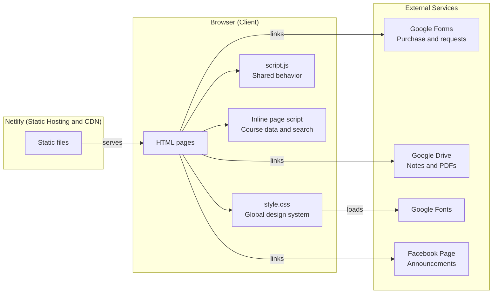
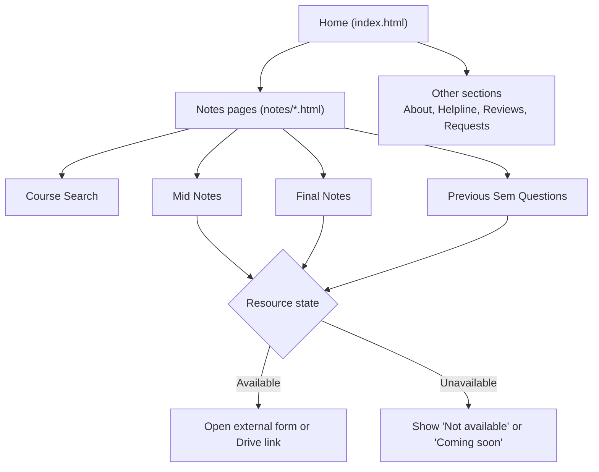
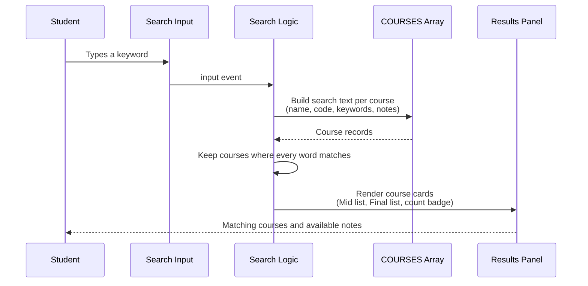
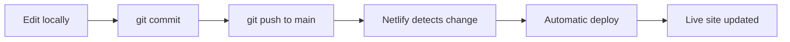

# EJN

A static study resource hub for Daffodil International University (DIU) Software Engineering students. EJN gives students one place to find course notes, previous semester questions, and support, organized by batch and semester.

Live site: deployed on Netlify from this repository.

---

## Table of Contents

1. [Overview](#overview)
2. [Features](#features)
3. [System Architecture](#system-architecture)
4. [Project Structure](#project-structure)
5. [Page Flow](#page-flow)
6. [Search Module](#search-module)
7. [Design System](#design-system)
8. [Getting Started](#getting-started)
9. [Content Management](#content-management)
10. [Deployment](#deployment)
11. [Author](#author)
12. [License](#license)

---

## Overview

EJN is a lightweight, framework-free website. It is built with plain HTML, CSS, and JavaScript, with no build step and no package dependencies. Static hosting keeps it fast, free to run, and simple to update.

| Item | Detail |
|---|---|
| Type | Static multi-page website |
| Audience | DIU Software Engineering students (SWE batches) |
| Stack | HTML5, CSS3, vanilla JavaScript |
| Hosting | Netlify |
| Build step | None |
| Backend | None (external services only) |

---

## Features

- **Course notes by batch and semester:** Mid and Final note listings per batch, such as SWE-43 Fall 2026.
- **Live course search:** Students search by course name, code, or keyword and instantly see what is uploaded for Mid and Final.
- **Previous semester questions:** Question archives linked per exam type.
- **Purchase and request flow:** Course purchase and missing-course or tutor requests are handled through external forms.
- **Grouped note listings:** Search results support group headings (for example Theory and Math) with indented items.
- **Status handling on buttons:** Unavailable resources display "Not available" or "Coming soon" on click instead of linking out.
- **Responsive layout:** Works on desktop and mobile with a single shared stylesheet.
- **Zero dependencies:** Nothing to install, nothing to compile.

---

## System Architecture

EJN is a static front end. All dynamic behavior runs in the browser, and everything that needs storage or submission is delegated to external services.



### Architectural Decisions

| Decision | Rationale |
|---|---|
| Static site, no framework | Fastest load time, no build tooling, easy for any contributor to edit |
| One global stylesheet | Consistent look across all pages and a single place to change the theme |
| Course data as a JavaScript array | Content updates need only a data edit, not a logic change |
| External forms and Drive | No server or database to maintain or secure |

---

## Project Structure

```
ejn-netlify/
|-- index.html            Landing page and main navigation
|-- style.css             Global stylesheet and design tokens
|-- script.js             Shared behavior (accordions, page transitions)
|-- notes/
|   |-- swe-43.html       Notes page for batch SWE-43 (search, Mid, Final, previous questions)
|   `-- ...               Additional batch and section pages
`-- README.md
```

Each subpage links to `../style.css` and `../script.js`, so every page inherits the same theme and behavior.

---

## Page Flow



---

## Search Module

The search feature lives in an inline script at the bottom of each notes page. It reads a single `COURSES` array and renders matching course cards on every keystroke.



### Course Data Schema

```javascript
{
  name: 'Software Quality Assurance & Testing',
  code: 'SE-312',
  keywords: 'sqa qa testing',
  mid: [
    'Introduction',
    '#Theory:',          // '#' prefix creates a group heading
    'Fundamentals',      // items after a heading are indented
    '#Math:',
    'BVA'
  ],
  final: []              // empty array shows "Nothing uploaded yet"
}
```

| Field | Purpose |
|---|---|
| `name` | Display name of the course |
| `code` | Official course code |
| `keywords` | Extra search terms and abbreviations |
| `mid` | Notes available for the Mid exam |
| `final` | Notes available for the Final exam |

Rules:

- All typed words must match somewhere in the course name, code, keywords, or note titles.
- Entries starting with `#` are group headings and are not counted as notes.
- The availability badge shows the number of real notes, or "Coming soon" when there are none.

---

## Design System

All visual tokens are defined once in `style.css` as CSS custom properties.

| Token | Value | Use |
|---|---|---|
| `--bg` | `#F6FBF7` | Page background |
| `--surface` | `#FFFFFF` | Cards and panels |
| `--surface2` | `#EFF8F1` | Hover and secondary surfaces |
| `--border` | `#D7EBDC` | Borders and dividers |
| `--accent` | `#16A34A` | Primary green accent |
| `--accent2` | `#15803D` | Deep green for hover and emphasis |
| `--text-main` | `#16231A` | Primary text |
| `--text-muted` | `#4B5D53` | Secondary text |
| `--highlight` | `#E7F6EB` | Tinted highlights |

Reusable components: navigation cards, accordions, drive cards, section blocks, info boxes, review cards, and status buttons.

---

## Getting Started

No installation is required.

### Option 1: VS Code Live Server

1. Clone the repository.
2. Open the folder in VS Code.
3. Right-click `index.html` and choose **Open with Live Server**.

### Option 2: Open directly

Open `index.html` in any modern browser. Note that relative links work best through a local server.

```bash
git clone https://github.com/es-ratt/ejn-netlify.git
cd ejn-netlify
```

---

## Content Management

Most updates touch one place only: the `COURSES` array at the top of the inline script in each notes page.

**Add a new note to a course**

```javascript
mid: ['Chapter 1 Notes', 'Chapter 2 Notes', 'New Note Title'],
```

**Add a new course**

```javascript
{
  name: 'Course Name',
  code: 'XX-000',
  keywords: 'short names people search',
  mid: [],
  final: []
}
```

**Change a button state**

Purchase and PDF buttons use a simple `onclick` text swap:

```html
<button type="button" class="drive-btn"
  onclick="this.textContent='Not available';">Collect PDF</button>
```

Replace the button with an anchor tag pointing to the form or Drive folder when the resource goes live.

---

## Deployment

The site is deployed on Netlify as a plain static site.

| Setting | Value |
|---|---|
| Build command | None |
| Publish directory | Repository root (`/`) |
| Branch | `main` |



Every push to `main` triggers an automatic redeploy.

---

## Author

**Esrat Jhahan Nur**
Software Engineering student, Daffodil International University

- GitHub: [es-ratt](https://github.com/es-ratt)
- LinkedIn: [esratjhahann](https://linkedin.com/in/esratjhahann/)

---

## License

All rights reserved. Study materials linked from this site belong to their respective authors. Contact the author before reusing or redistributing any content.